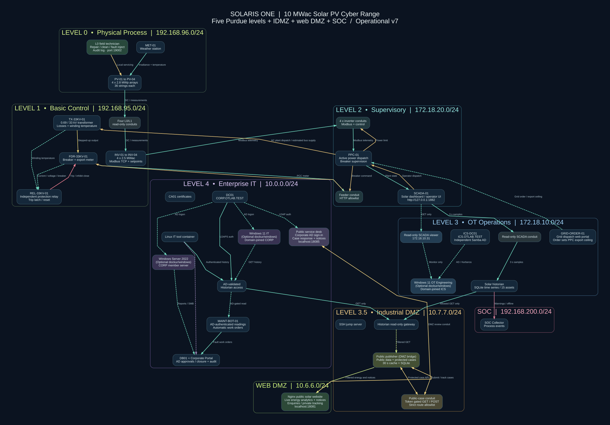

# Purdue OT + Active Directory lab (Docker Compose)

## Solar plant digital twin simulator — NEW

This ZIP now contains an **additive 100 MW solar cyber-physical process mode**, with 4 individually working Modbus/TCP inverter devices, a PPC issuing real simulated Modbus setpoints, an independent protective relay, live browser SCADA, physics-linked weather/PV/transformer/PCC behavior, a SQLite historian, and a CORP AD-backed read-only historian gateway through the industrial DMZ. The plant values all originate from one authoritative simulator, rather than independently generated random data. **This is not a calibrated twin of a particular real plant** because no site-specific telemetry or equipment parameters were provided.

```bash
python3 scripts/init_env.py
./scripts/up.sh --solar           # existing Purdue/AD base + functional solar lab
# SCADA: http://127.0.0.1:1883
# AD-authorized plant data: http://127.0.0.1:18084/api/latest
./scripts/check_solar.sh         # when Samba AD and all services are ready

# Without Docker, test real loopback HTTP/Modbus device processes:
python3 scripts/test_solar_local.py
```

`./scripts/up.sh --full-solar` additionally includes the original mrhOTshOT targets **after** running `./scripts/setup.sh`. See **[Complete solar twin documentation](docs/SOLAR_DIGITAL_TWIN.md)**, the [solar Purdue topology](docs/solar_twin.svg), and the [synthetic CSV model validator](solar/validate_plant_data.py). **Docker/AD end-to-end deployment has not been verified in this build environment.** The complete solar service chain *has* been tested locally with actual TCP devices and HTTP services.

---

**Purdue Levels 0, 1, 2, 3, and 4** plus an Industrial DMZ (3.5), web DMZ, and SOC. Based on the attached reference network illustration and the published [mrhOTshOT_Docker_pub](https://github.com/AsherDLL/mrhOTshOT_Docker_pub) architecture, with a separate [Samba 4 Active Directory](https://helgeklein.com/blog/samba-active-directory-in-a-docker-container-installation-guide/) build for the IT and OT operations zones.

> **Status:** Local Python/Modbus/SCADA/historian smoke test and static topology/unit tests passed. **Not fully container-tested.** Docker Engine and network registry access are unavailable in the package-building environment; upstream source is **not included in this ZIP**. Run `scripts/setup.sh` on your Docker Linux machine to clone the original Apache-2.0 project and generate the full Compose overlay. AD provisioning and upstream FUXA interoperability require deployment checks. The package contains an independent *core* deployment as well as the mrhOTshOT adapter.

## What you actually get

- **Level 0** synthetic tank, pump, temperature and flow process, with a small field I/O API. These are simulations, not physical sensors.
- **Level 1** working demo Modbus TCP controller (read functions 03/04, setpoint write function 06) with closed-loop pump logic. In *full mode*, also the existing upstream **11 `plc-*` target services plus the `sis` safety simulator**. The upstream README describes twelve emulated PLCs, but its published Compose file names 11 `plc-*` services and a separate SIS.
- **Level 2** working browser-based SCADA simulation that polls Level 1 Modbus across a restricted TCP conduit. Full mode also brings up the upstream FUXA HMI, with its `plc-heating` name resolved to a dedicated Modbus port relay.
- **Level 3** SQLite historian that polls Level 2 telemetry through a read-only HTTP conduit; independent Samba domain `ICS.OTLAB.TEST` with `ics-dc01`.
- **Level 3.5** Industrial DMZ with SSH jump server, host entry relay, and read-only historian relay.
- **Level 4** Samba Active Directory domain `CORP.OTLAB.TEST`, `dc01`, pre-created analyst account, Linux IT workstation with Kerberos/LDAP tools, PostgreSQL `db01`, and an OpenSSL-based **demonstration CA** (`ca01`; *not* Microsoft AD CS).
- **AD-backed historian access:** HTTP gateway verifies enterprise analyst credentials via LDAPS against `dc01` then forwards read-only historian requests through the IDMZ to Level 3. No IT endpoint has a native L1/L0 interface.
- **SOC** SQLite JSON event sink and optional Elasticsearch/Kibana (`--profile elastic`); passive Malcolm/Zeek/Suricata and Windows EDR are **not bundled** and require external integrations.
- **Web DMZ** a static Nginx web server on 10.6.6.0/24. Optional `attacker` terminal and synthetic WAN (profile `redteam`), but no external Internet link or route to enterprise IT.

**Important:** Two AD domains are **independent**. `ics-dc01` is not a read-only replica, child domain, or trust partner of `dc01`; no replication or forest trust is configured. The Linux workstation supports Kerberos and LDAP but is **not automatically domain-joined**. The SSH jump server uses a separate local account (`labops`), not AD-PAM. AD verification is enforced only by the HTTP historian access gateway.

## Subnet map

| Function | Network | Key services |
| --- | --- | --- |
| Purdue Level 4 corporate IT | `10.0.0.0/24` | DC01 `10.0.0.10`, CA01, DB01, IT workstation |
| Simulated WAN | `198.18.0.0/24` | optional attacker toolbox, HTTP web entry conduit |
| Web DMZ | `10.6.6.0/24` | static Nginx web app |
| Purdue Level 3.5 industrial DMZ | `10.7.7.0/24` | SSH jump, historian conduit |
| Purdue Level 3 OT operations | `172.18.10.0/24` | historian, ICS-DC01 `172.18.10.10` |
| Purdue Level 2 supervisory | `172.18.20.0/24` | SCADA, FUXA (full mode) |
| Purdue Level 1 control | `192.168.95.0/24` | demo PLC, upstream protocol targets and SIS (full mode) |
| Purdue Level 0 process | `192.168.96.0/24` | synthetic tank/pump/sensors |
| SOC | `192.168.200.0/24` | event collector, optional Elastic/Kibana |

All nine networks are Docker `internal: true` bridges. None connects to your production VLAN or Internet, but published localhost web ports remain reachable on the host and containers may still be reachable from a sufficiently privileged Docker host. **Use a dedicated Proxmox VM** and verify no subnet conflicts with other services or host routes.



See [docs/topology.svg](docs/topology.svg), [docs/topology.dot](docs/topology.dot), and [assets/reference_topology.png](assets/reference_topology.png).

## Quick start: Linux Docker host (core, without upstream)

Prerequisites: Docker Engine + Compose v2, Python 3.8+; 8 GB RAM recommended for core, ~16 GB RAM and 20+ GB disk for full build, and more if enabling Elasticsearch/Kibana or separately deploying Malcolm. On Ubuntu you can install Git and PyYAML with `sudo apt-get install git python3-yaml`; install Docker Engine/Compose following Docker's official instructions. On a Linux host using rootless Docker or Docker Desktop, Samba ACL/extended-attribute permissions may need adjustments.

```bash
unzip Purdue_OT_AD_Lab.zip
cd Purdue_OT_AD_Lab
python3 scripts/init_env.py              # one-time secure .env, chmod 600
python3 scripts/validate.py              # validate topology config
./scripts/up.sh                          # core: no clone needed
# Check state after containers are running:
docker compose ps
docker compose logs --tail=30 dc01 ics-dc01
./scripts/check_lab.sh
```

First-time AD provisioning can take time; retry `check_lab.sh` if DC01 has not yet started LDAPS. If provisioning fails, see `docs/TROUBLESHOOTING.md` before deleting volumes.

## Full mode: add original mrhOTshOT target services and FUXA

```bash
# Git, PyYAML, Docker Compose and external registry access are required.
./scripts/setup.sh
# Clones upstream into ./upstream; keeps it unchanged.
# Generates ./compose.mrhotshot.yaml with original targets + FUXA
./scripts/up.sh --full

docker compose -f compose.yaml -f compose.mrhotshot.yaml ps
# Seed original FUXA HMI once its HTTP endpoint is ready:
(cd upstream && python3 scripts/seed_fuxa_hmi.py --wait)
```

**Compatibility:** We deliberately do **not** start the original `router`, `caldera`, `caldera-agent`, or Docker-socket-mounted attack console in strict mode. Original scripts and Caldera scenarios assume the common `otlab` network and are not guaranteed to run through these conduits. If you need all original scripts, use the upstream project's original Compose configuration in an **entirely separate disposable VM**, not simultaneously with strict mode. Do not connect either to live plants.

For FUXA's pre-seeded Modbus connection to `plc-heating:502`, the L2 DNS alias points to `control-conduit` (TCP port 502) which forwards to the true upstream `plc-heating` service in L1. Other original FUXA device mappings or scripts might need adjusted target addresses and gateway port mappings.

## Access and examples

| Interface | Host URL / endpoint | Access policy |
| --- | --- | --- |
| Demo SCADA | `http://127.0.0.1:1882/` | Loopback only, demo visualization |
| Corporate AD gated historian | `http://127.0.0.1:18080/api/latest` | HTTP Basic `analyst` with password in local `.env`, backed by `dc01` LDAPS |
| Historian history | `http://127.0.0.1:18080/api/history?limit=20` | Same AD login |
| Jump (SSH) | `ssh -p 2222 labops@127.0.0.1` | Local password `JUMP_PASSWORD` in `.env` |
| SOC events | `http://127.0.0.1:19090/api/events` | Loopback only |
| Web DMZ | `http://127.0.0.1:18081/` | Loopback only |
| Upstream FUXA (full) | `http://127.0.0.1:1881/home` | Original FUXA application security defaults |
| Elasticsearch (optional) | `http://127.0.0.1:19200/` | Isolated demo, no built-in security |
| Kibana (optional) | `http://127.0.0.1:15601/` | Isolated demo, no built-in security |

Test the AD-backed path without echoing passwords into shell history:

```bash
read -r -s -p 'Analyst AD password: ' AD_PASS; echo
curl -sS -u "analyst:$AD_PASS" http://127.0.0.1:18080/api/latest | python3 -m json.tool
unset AD_PASS

# DNS/Kerberos: service records and a ticket request from an IT client
# (use CORP_AD_ANALYST_PASSWORD from .env interactively for kinit):
docker compose exec it-workstation dig @10.0.0.10 _ldap._tcp.corp.otlab.test SRV
docker compose exec it-workstation kinit analyst@CORP.OTLAB.TEST

# Inspect the OT domain in Level 3:
docker compose exec ics-dc01 samba-tool domain level show
```

### Expected communication path

`IT workstation → it-access (validates against CORP DC01 using LDAPS) → L3.5 historian-conduit → L3 historian → L3/L2 supervisory-conduit → L2 SCADA → L2/L1 TCP control-conduit → L1 PLC → L1/L0 field-conduit → L0 tank/pump`.

IT can view historical/supervisory results, **not send PLC commands via the authenticated historian gateway**. The Level 1 Modbus setpoint write in the separate control demo is intentionally available within the L1 and designated L2 conduit, not from IT.

### Optional simulated WAN attacker terminal

This only provides a benign network-toolbox node for validating the web DMZ path. The attacker is **not connected to real WAN/Internet or Level 4 IT**.

```bash
docker compose --profile redteam up -d attacker
# From the isolated WAN client, web-entry exposes only the synthetic DMZ web server:
docker compose exec attacker curl http://web-entry:8080/
```

### SOC and Elasticsearch

```bash
# Optional, requires more RAM and Docker memory map tuning as documented by Elastic:
docker compose --profile elastic up -d elastic kibana
# Incoming historian alerts are stored in local SQLite even when Elastic is absent.
# Once Elastic is up, the SOC collector attempts to mirror new events into
# Elasticsearch index 'purdue-events'.
```

No periodic anomaly is guaranteed: the historian emits an event when thresholds are breached. To test the event pipeline from L3:

```bash
docker compose exec historian python -c 'import json,urllib.request,time; data=json.dumps({"time":time.time(),"source":"test","severity":"info","event":"end_to_end_validation"}).encode(); urllib.request.urlopen(urllib.request.Request("http://soc-conduit:8080/api/events",data=data,headers={"Content-Type":"application/json"}),timeout=4).read()'
curl -sS http://127.0.0.1:19090/api/events | python3 -m json.tool
```

For Malcolm, Zeek and Suricata, see [docs/INTEGRATIONS.md](docs/INTEGRATIONS.md). **There is no automatic SPAN mirror**: connecting a packet capture sensor to a Docker bridge does not automatically deliver all switched inter-container packets to that sensor. Capture from the correct host bridge/interface or use explicit Linux traffic mirroring.

## Safe shutdown and reset

```bash
./scripts/down.sh  # preserves persistent volumes and AD domain databases
# Destructive lab reset (removes accounts, SQL historian, SOC, CA and FUXA data):
docker compose -f compose.yaml -f compose.mrhotshot.yaml down -v   # full mode only
# core-only reset: docker compose down -v
```

**Security notes**

This is an intentionally synthetic isolated OT lab, not a production reference design. The lab-only AD gateway permits HTTP Basic on host loopback and unverified self-signed LDAPS inside isolated bridges. The SSH jump host uses password authentication. The optional Elastic profile disables its own auth, so **never publish lab ports beyond loopback or attach the SOC network to real networks**. Audit all services and add real PKI/TLS, AD role mapping, MFA, host firewalls and monitoring before adapting any part to a real environment. A compromised dual-network application conduit could still pivot between its two networks; `ip_forward=0` reduces generic routing but is not a substitute for independent firewalling. Samba may need elevated host filesystem permissions to store AD security xattrs; keep this on a dedicated disposable VM.

The upstream `lab_config.json` and Caldera configuration contain sample/default credentials and private environment information; **do not publish the `upstream/` directory or run upstream's attack console publicly**. Our package uses generated passwords and never includes upstream source/credentials. All process names and readings are simulations, and industrial functions are provided for authorized detection testing only.

## Testing coverage

```bash
python3 scripts/validate.py
python3 -m unittest discover -s tests -v
python3 scripts/smoke_local.py
```

The smoke test launches Python field, PLC, SCADA, historian and SOC components on localhost with ephemeral SQL databases; it checks a true Modbus TCP response and setpoint write. It cannot validate Compose networks, Samba ACL/DNS/LDAPS at runtime, Docker image availability, FUXA seeding, or the external upstream repo download. Validate those on a real lab VM using the documented commands.

## Source and licensing

Original lab: [AsherDLL/mrhOTshOT_Docker_pub](https://github.com/AsherDLL/mrhOTshOT_Docker_pub), Apache-2.0, original credit to Asher Davila and Malav Vyas. The adapter generates service YAML from the locally cloned repo; it does not modify or redistribute its Python attack code. Dockerfiles and software downloaded by the upstream build have their own licenses. Samba AD design concepts based on [Helge Klein's 2026-updated container installation guide](https://helgeklein.com/blog/samba-active-directory-in-a-docker-container-installation-guide/); the custom Samba Dockerfile here is independent and not copied from his repository.
