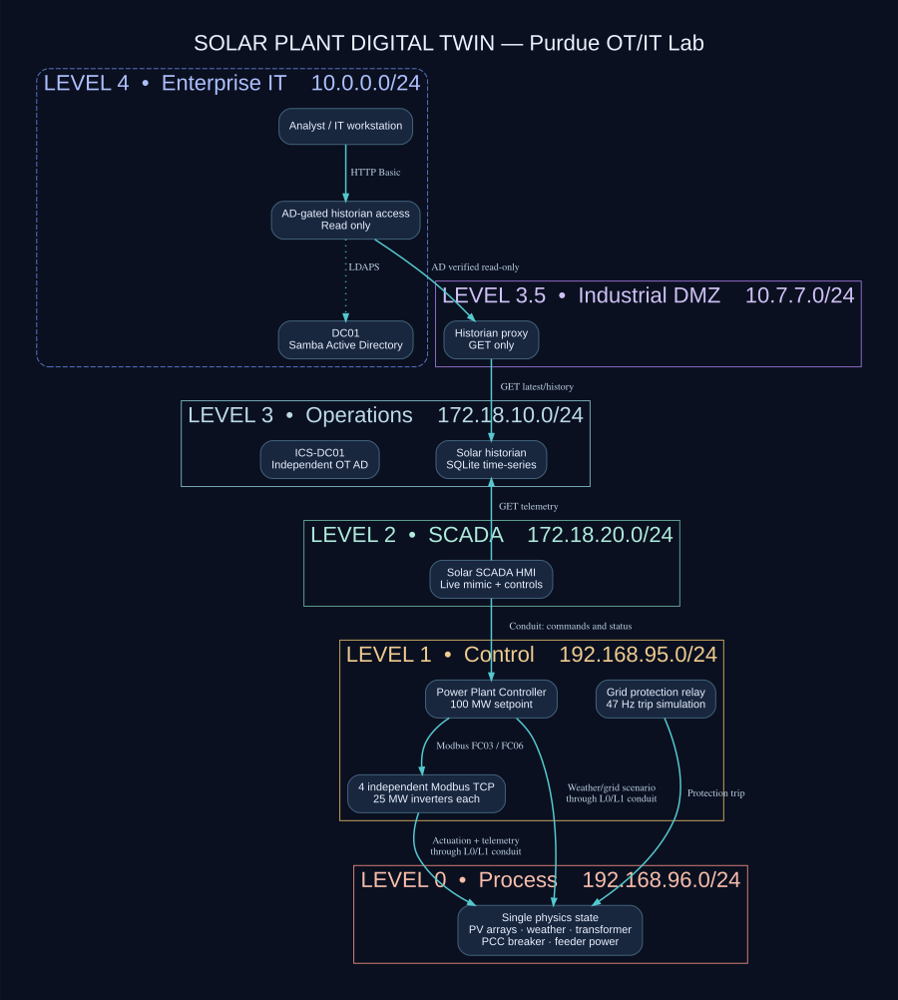

# 100 MW solar power plant — functional cyber-physical twin simulation

**Version:** October 2026 · **Status:** working local functional simulation, **not a commissioned or validated real-plant digital twin**.

The solar mode is additive to the existing Purdue/AD lab, without attaching any software to real equipment. It starts a separate **single-state** physics process, four **independently addressable** Modbus/TCP inverter devices, a PPC, an independent Level 1 protective relay, interactive L2 SCADA, and a persistent L3 historian. An enterprise AD-validated read-only history gateway exposes the plant history at Level 4 through the IDMZ.

## Quick start

On a **dedicated Linux Docker VM** with Docker Engine + Compose v2 and Python installed:

```bash
unzip Solar_Digital_Twin_Purdue_Lab.zip
cd Purdue_OT_AD_Lab
python3 scripts/init_env.py
python3 scripts/validate.py
./scripts/up.sh --solar
# SCADA: http://127.0.0.1:1883
# AD gated solar historian: http://127.0.0.1:18084/api/latest
# After AD initializes:
./scripts/check_solar.sh
```

Optional: use `./scripts/setup.sh` to clone the external mrhOTshOT project and generate its Compose overlay; then deploy `./scripts/up.sh --full-solar`. **Original upstream attack scripts and dashboard are NOT guaranteed to work in the strict Purdue mode.** For a fully isolated solar installation independent of mrhOTshOT source, only `--solar` is needed.

Shutdown: `./scripts/down.sh --solar` to stop the project while retaining its volumes. `docker compose -f compose.yaml -f compose.solar.yaml down -v` **deletes AD, SQL and historian volumes**.

**Recommended:** 16 GB RAM, 4 vCPUs, 20 GB free disk for the combined core + solar services. AD first boot and other original services can need additional resources. Docker image pulls require network access during setup; all lab zones are marked `internal: true` after creation.

## Zones and component behavior



| Zone | Containers | Protocol / behavior |
|---|---|---|
| L0 | `solar-physics` | Authoritative weather, PV array DC, inverter power balance, transformer, PCC voltage/frequency, energy counters (HTTP only inside L0) |
| L0/L1 conduit | `solar-field-conduit` | Only `/api/state` GET and `/api/command` POST allowed across bridge |
| L1 | `solar-inverter-01`…`04` | Four separate Modbus TCP on port 502, read data and actuator controls |
| L1 | `solar-ppc` | Polls all four Modbus inverter endpoints; sends FC06 active-power limits based on PCC MW target |
| L1 | `solar-protection-relay` | Independent protection model opens PCC breaker for grid source frequency outside 49–51 Hz or voltage outside 30–36 kV |
| L1/L2 conduit | `solar-ppc-conduit` | HTTP allowlisted PPC state and command |
| L2 | `solar-scada` | Browser process mimic, four live inverter cards, trends, PPC/weather/fault commands; port 1883 on host loopback |
| L2/L3 conduit | `solar-supervisory-conduit` | GET-only SCADA state |
| L3 | `solar-historian` | Polls all state and stores `solar.sqlite3` samples including the four inverters |
| L3/IDMZ conduit | `solar-historian-conduit` | GET-only latest and history |
| L4/IDMZ conduit | `solar-it-access` | Authenticates via Samba CORP.OTLAB.TEST LDAPS, allows **read-only historian**; port 18084 on host loopback |

The original IT AD domain (`dc01`) and OT AD domain (`ics-dc01`) remain independent. **There is no AD domain join on the Linux PLC devices**. Cross-zone HTTP relay containers are application conduits, **not a firewall certification or an IEC 62443 security-level assessment**. Any node in Level 1 may access the L0 command conduit; it is a demonstration trust boundary, not production-grade authenticated control.

## Plant model

Synthetic design capacity: **4 inverter blocks × 25 MW AC = 100 MW AC; 4 PV DC blocks × 27.5 MWp = 110 MWp DC.** (No real plant specified.) The active power model implements:

```text
T_cell [°C]            = T_ambient + 0.03 × plane-of-array irradiance [W/m²]
P_dc_per_block [MW]    = 27.5 × (irradiance / 1000)
                          × max(0, 1 − 0.0035 × (T_cell − 25)) × 0.97
P_available_ac [MW]    = min(25, P_dc_per_block × 0.96)
P_inverter [MW]        = min(P_available_ac, PPC-issued inverter limit)
                          when inverter and PCC breakers are closed, else 0
P_PCC_export [MW]      = sum(P_inverter) × (1 − 0.015)
```

**This is PVWatts-inspired, not PVWatts reproduction or a full power-flow simulation.** The input is effective plane-of-array irradiance, not a site-specific sun-position/tilt/shading/weather model. The cell-temperature proxy is simplified. The 3% loss is an illustrative DC derate, 96% conversion efficiency, and 1.5% transformer/collector loss are demonstration parameters, not actual engineering figures. Energy integration is time-based within the running L0 service; state **resets when the physics container restarts**. The Level 3 historian has durable volume persistence.

PPC interprets `plant_limit` as **grid export MW**, not total inverter power, so the dispatch allocation includes the illustrative 1.5% feeder loss. At G = 1000 W/m² and ambient 25 °C, the available AC export is approximately 90 MW. Sending a **40 MW** limit causes all four inverters to curtail and exports approximately 40 MW. If sunlight falls below the 40 MW available limit, actual export drops below the command — a limit cannot create solar energy.

The protection relay intentionally uses simple frequency/voltage thresholds and directly opens the synthetic PCC breaker. It does **not** implement realistic relay coordination, time-current curves, fault analysis, dynamic voltage models, or SIL/SIS certification.

## Real device communication and register map

`solar-inverter-01:502` through `solar-inverter-04:502` are **four distinct Modbus servers** on Level 1. These are **custom educational register assignments, not official SunSpec models**. Register indexes below are zero based (`FC03`/`FC04`); no unit-ID specific behavior is modeled.

| Holding register | Meaning | Scaling |
|---|---|---|
| 0 | measured AC output | kW |
| 1 | available DC generation | kW |
| 2 | commanded inverter active-power limit | kW |
| 3 | inverter online flag | 0/1 |
| 4 | local inverter breaker closed | 0/1 |
| 5 | irradiance | W/m² |
| 6 | cell temperature | °C × 10 |
| 7 | PCC frequency | Hz × 100 |
| 8 | PCC voltage | kV × 100 |
| 9 | integrated inverter energy | MWh × 100, 16-bit saturation |
| 100 (FC06 write only) | inverter active-power setpoint | 0–25000 kW |
| 101 (FC06 write only) | inverter breaker state | 0/1 |

HTTP/UI instructions use `solar-scada` only. For low-level detection work in the simulator, use a separate debug container attached to the Level 1 bridge. Do not publish Modbus TCP from the host or from Level 4.

## Operator experiments

Open **http://127.0.0.1:1883**. The display is driven by the L1 PPC and the **same** L0 state used by the actual Modbus register servers.

1. Select `Apply PPC curtailment` with **40 MW**. All four inverters receive FC06 write commands; aggregate PCC export should approach 40 MW.
2. Press `Cloud passing` (350 W/m²). Physical irradiance falls; PV DC production, inverter AC generation, and PCC export decrease together. The PPC remains capped at 40 MW but may not reach it.
3. Press `47 Hz fault test`. The independent synthetic protection relay opens the PCC breaker. Grid export and inverter production fall to **0 MW**.
4. Press `Reset plant` to restore normal weather, breaker state, inverter limits and PPC export target.
5. Query the AD-gated historian at Level 4 (requires `analyst` password in `.env`):

   ```bash
   read -r -s -p 'AD analyst password: ' AD_PASS; echo
   curl -u "analyst:$AD_PASS" http://127.0.0.1:18084/api/latest
   curl -u "analyst:$AD_PASS" 'http://127.0.0.1:18084/api/history?limit=20'
   unset AD_PASS
   ```

**Note**: simulator controls have no login inside the isolated L2 SCADA; they are training controls. Host-published web port 1883 is only bound to `127.0.0.1`, not reachable directly from your LAN. Keep all lab services in a disposable Proxmox VM away from live ICS networks.

## Checks and failure diagnosis

```bash
# Local smoke test does NOT require Docker; launches actual HTTP and Modbus services:
python3 scripts/test_solar_local.py
python3 -m unittest discover -s tests -v
# Static zone/link/published-port validation:
python3 scripts/validate.py
# Against a running Docker host, includes AD LDAPS and historian checks:
./scripts/check_solar.sh
# Investigate services that failed:
docker compose -f compose.yaml -f compose.solar.yaml ps
docker compose -f compose.yaml -f compose.solar.yaml logs -f solar-ppc solar-inverter-01 solar-protection-relay solar-historian
```

`depends_on` controls start order but does **not** guarantee service readiness; the PPC and historian retry until services become available. A disconnected SCADA badge may indicate that one or more inverters have not started. The original Samba setup uses `SYS_ADMIN` and persistent volumes and may have additional kernel/filesystem requirements; a first-boot AD failure does not mean the solar process devices themselves are nonfunctional.

## Relationship to a real operational digital twin

No asset naming file, electrical single-line diagram, geolocation, SCADA tag map, historian export, weather series, inverter manufacturer/model, protection settings or live gateway credentials were supplied. **The package therefore does not claim to represent, predict or control any specific real power plant.** It is an **integrated cyber-physical testbed** with a model suitable for later calibration.

A practical next stage is a **read-only** plant telemetry adapter (OPC UA, IEC 104, ICCP, historian API, or approved SCADA export) with OT network approvals and passive security review; map real tag IDs to inverter blocks, PPC power limits, PCC active power, breaker state, irradiance and temperature. Validate timestamp alignment, site-specific conversion losses, deadbands, PV clipping, local setpoint ramp rates, grid/load dynamics, and uncertainty; add a calibrated site model and alert on residuals. Do not send synthetic PPC or SCADA commands into real production equipment.

A minimal CSV validator is included:

```bash
python3 solar/validate_plant_data.py examples/SYNTHETIC_validation_example.csv
python3 solar/validate_plant_data.py /path/to/your_plant_export.csv
```

Required CSV columns: `irradiance_wm2`, `ambient_c`, `observed_export_mw`; optional: `ppc_limit_mw` and `grid_breaker_closed`. This script evaluates a **steady-state** approximation and reports MAE/RMSE/bias in MW. The included example is explicitly synthetic. Comparing only a few points is insufficient to validate a real twin.

## Model references

- [pvlib Python PVWatts DC model](https://pvlib-python.readthedocs.io/en/latest/reference/generated/pvlib.pvsystem.pvwatts_dc.html)
- [NREL/NLR System Advisor Model photovoltaic modeling overview](https://sam.nlr.gov/photovoltaic/)
- [SunSpec Alliance Modbus — authoritative standard context](https://sunspec.org/modbus/) — register map above is **not** a SunSpec-certified implementation.
